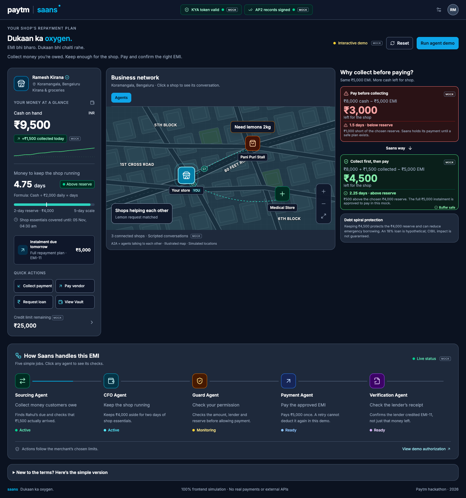

# Paytm Saans — Dukaan ka oxygen

A frontend-only hackathon demo that explains how collecting money owed before an EMI repayment can preserve operating cash.

Ramesh starts with ₹8,000. Paying the ₹5,000 EMI immediately leaves ₹3,000, below his chosen ₹4,000 reserve. The mock collects ₹1,500 from Rahul first, checks permission, pays ₹5,000 once, and matches a simulated lender receipt. ₹4,500 remains: 2.25 days of essentials at ₹2,000/day.

All merchants, amounts, permissions, conversations, payment records and lender receipts are mock data. No backend, real payments, Sarvam calls, bank connections or external APIs are used. KYA and AP2 badges illustrate the intended checks; they do not verify real protocols. Credit-score outcomes are not predicted or guaranteed.

## Run locally

Requires Node.js 22.12+.

```sh
npm ci
npm run dev
```

Open http://localhost:5178/.

## Demo

1. Compare the red ₹3,000 path with the green ₹4,500 path.
2. Click **Run agent demo**. Watch collection, buffer count-up, permission checks, repayment and verification.
3. Click the EMI card for instalment details.
4. Click a map pin for a scripted shop conversation.
5. Click an agent to see its mock checks. Payment replay keeps the balance unchanged.

## Build and deploy

```sh
npm run build
```

Vercel detects Vite, runs `npm run build` and serves `dist`. No environment variables are required.

The UI, fixtures and interactions are in `App.jsx`. Tailwind is compiled locally, and Inter is bundled locally.


